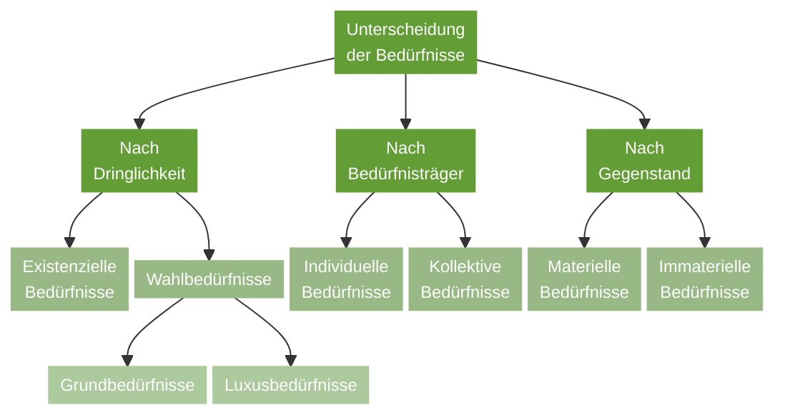
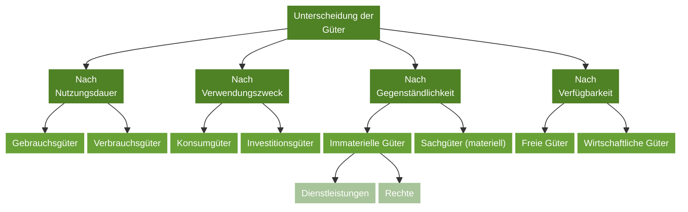
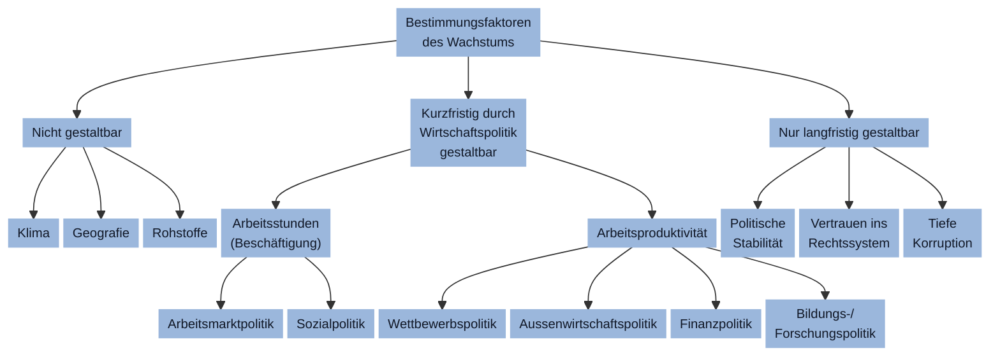

# Politik
## Staatsformen
### Einheitsstaat
Der Staat wird zentral und als eine Einheit geleitet, die drei Gewalten(Judikative, Exekutive, Leglisative) werden exklusiv vom Staat organisiert.
Wichtig ist zu wissen ist das es keine Gliedstaaten existieren, jedoch können diese eine Administrationseinheit haben, welche jedoch geringe kompetenz aufweist.
#### Einheitsstaat Beispiele
Frankreich oder Norwegen
### Bundesstaat
Zusammenschluss von Gliederstaaten/Teilstaaten (Kantone), dabei hat der Bund und auch die Mitglider haben eine Gewalt(Judikative, Exekutive, Leglisative)
#### Bundesstaat Beispiele
Schweiz mit den 26 Kantonen
USA mit den 50 Bundesstaaten

### Staatenbund
Zusammenschluss von selbständigen Staaten, damit gemeinsame aufgaben gelöst werden können.
Wichtig ist zu erkennen der Unterschied zum Bundesstaat hat es keine geminesame Rechtsgrundlage oder Staatsqualität.
#### Staatenbund Beispiele
UNO mit den 193 Länder
Nato mit den 32 Länder

## Demokratie
### Indirekte Demokratie
Das Volk wähltAbgeortnete (Leglistaltive) welche dann Gesetze/Verfassung bestimmen und die Exekutive (Regierung) wählen.
### Dierekte Demokratie
Das Volk wählt Abgeortnete (Leglistaltive), Exekutive (Regierung) wählen und kann Gesetze/Verfassung bestimmen.
### Halbdierekte Demokratie
Vermischt die Zwei grundformen.
#### In der Schweiz
Das Volk Wählt gesätze und Abgeordnete (Leglistaltive), kann jedoch keine Exekutive (Regierung) wählen, wolche von den Abgeordnete (Leglistaltive) gewählt werden.

## Föderalismuss
### Gewalten in der Schweiz
#### Bund
- Bundesregierung (Exekutive)
- Bundesparlament (Stände-/Nationalrat) (Leglistaltive)
- Bundesgerich
#### Kanton
- Kantonale Regierung (Exekutive)
- Kantonales Parlament (Leglistaltive)
- Kantonale Gerichte
#### Kanton
- Gemeinderat
### Föderalismuss in der Schweiz
Kompetenzen und die Macht werden zwischen Bund, Kantonen, und Gemeinden aufgeteilt. So kann die Kultur differenziert werden von Land zu Stadt und auch Region zu Region.
#### Subsidiarität
Eine Aufgabe soll (wenn möglich) vom der kleinsten Einheit (Gemeinde) Erledigt werden.

Somit wird bei grösseren Projekten die Aufgabe immer weiter nach oben geschoben, wie Ortsstrassen sind bei Gemeinden, Autostrassen sind bei Kantone, und die Autobahn ist beim Bund.

---

# Recht
## Gesetzesartikel Zitierweise
Abkürzungen:
Art. = Artikel (Die wichtigsete nummer)
Abs. = Abschnitt (II oder Abs. 2)
lit. = Litera (definiert Alphabetaufzählungen)
Ziff. = Ziffer (definiert Aufzählungen)

### Kurzform
ZGB 314a II Ziff, 2
ZGB 314b VI lit. a

### Langform
Art. 314a ZGB 2 Ziff, 2 ZGB
Art. 314b Abs. 6 lit. a ZGB
## Recht, Sitte oder Mora
### Recht
Beschreibt Verhaltensregel, die vom Staat festgelegt und durchgesetzt werden.
- Alle Banknoten bei der Steuererklärung angeben.
- Rechts kommende Fahrzeuge haben vortritt.
### Sitte
Beschreibt geselschaftliche Gepflogenheiten und Traditionen, welche wegen "der Form halber" eingehalten werden.
- Tür aufhalten für Freundin.
- Eine Verbeugen kann als Begrüssung gilten.
### Moral
Beschreibt die Innere Werte und Normen, welche das eigene Gewissen beinflussen.
- Veganer essen kein Fleisch
- Gegen die Einführung der Todesstraffe
## Privatrecht oder öffentliches Recht
### Privatrecht
- Zwischen Privatpersonen
- Wird bei beteiligung nur angewant
- Hauptsächlich dispositive Bestimmungen
#### Gesetze oder Rechtsgebiete
- ZGB, OR
- Gesetz gegen unlauteren Wettbewerb
- Urhebergessetz
- Markensschutzgesetz

### Öffentliches Recht
- Zwischen Bund und Rrivatperson
- Wird von Ämter automatisch angewandt
- Hauptsächlich zwingende Bestimmungen
#### Gesetze oder Rechtsgebiete
- Bundseverfassung
- Steuerrecht
- Bauvorschriften
- Verhaftungssrecht

## Dispositives und zwingendes Recht
Bildet eine sogenannte "Legaldefinition" oder Vorschriften.
### Dispositives Recht
Ist unzwingend gültig, da es alternativen erlaubt.
- ... sofern nichts anderes definiert.
- Wird es nicht anders definiert, dann ...

### Zwingendes Recht
Ist definitiv das es giltb bei der bestimmten bedingung:
- ... fals nicht eingehalten, dann ...
- ... ist zwingend.

## Prozessarten bzw. Verhaltensart
Der Name vom Prozess zwischen Staat => Bürger, Bürger => Bürger, Bürger => Staat.

### Zivilprozess
Definiert Bürger => Bürger, da beide Bürger sind.
- Bürger verklagt seinen Mieter (Bürger)

### Strafprozess
Definiert Staat => Bürger, da beide Bürger sind.
- Bürger hat nicht alles Steuerbare eingommen angegeben.

### Verwaltungsverfahren
Definiert Bürger => Staat, da beide Bürger sind.
- Bürger wird sein Arbeitslosengeld gekürtz und rekurriert (Gesetz anfechten).

## Normenhierarchie (Bund)
Die Hierarchie der Gesetze und Verfassungen, sowie verträge.
## 0. Völkerrechtliche Normen
Geweissen Normens stehen über der BV.
### 1. Bundesverfassung
Auf erster stuffe die Bundesverfassung (BV)

### 2. Bundesgesetz und völkerrechtlicher Vertrag
Auf zweiter Stuffe die Bundesgesetz und völkerrechtlicher Vertrag.

### 3. Verordnung
Auf dritter Stuffe die Verordnung.

### Normenhierarchie Kanton
Auf kantonaler Ebene ist die Normenhierarchie identisch:
1. Kantonsverfassung
2. Kantonsgesetz
3. Kantonsverordnung
### Normenhierarchie Gemeinde (Kommunal)
Auf kantonaler Ebene ist die Normenhierarchie identisch:
1. Gemeindeordnung
2. Gemeindereglement
3. Gemeindeverordnung

---

# Wirschaft
## Bedürfnisse

## Güter

## Brutton inland Produkt (BIP)
Es misst den Gesamtwert aller Güter und Dienstleidtungen, die währen eines Jahres innerhalb einer Volkswirtschaft hergestellt werden und dem Endverbrauch dienen.
### Wirtschaftswachstum
Darunter versteht man die langfristige
wirtschaftliche Entwicklung.
Das BIP im Vergleich zum Vorjahr zeigt uns die wirtschaflitch Entwicklung.

### Pro Kopf
Die BIP zahl geteilt durch die Einwohnerzahl, damit können die einzelnen Länder untereinander verglichen werden.
### Real
BIP wird mit Preisen vom Vorjahr / Basisjahr berechnet.
Im vergleich gibt das ein Reales Wachstum im Vergleich zum Vorjahr.
- Preisbereinigt, meist tiefer als das nominale
### Nominal
BIP nach dem aktuellen (laufenden) Preisen berechnet.
Im vergleich gibt das ein Nominelles Wachstum im Vergleich zum Vorjahr.
- Meist höher als Real
## Angebot und Nachfrage
Beim Schneidepunkt ist das Marktgleichgewicht.

### Angebot
#### Gesetz
Je höher der Preis, desto höher das Angebot.
### Nachfrage
#### Gesetz
Je tiefer der Preis, desto höher die Nachfrage.
## Wirtschaftskreislaufs

## Magischessechseck
Beinhaltet 6 wichtige Punkte welches eine gute Wirtschaft erfüllen sollte.
### 1. Vollbeschäftigung
Keine Arbeitslosigkeit, somit volle effizeinz
### 2. Wirtschaftswachstum
Stetisches Waches von der Wirtschaft
### 3. Preisstailität
Lokt mehr Investoren ins Land, somit mehr wachstum.
### 4. Umweltqualität
Schützt die Natur und Umwelt, damit die Lebensqualität nich darunter leidet
## 5. Aussenwirtschaftliches Gelichgewicht
Gleicher Import wie Export, damit die Wirtschaft nicht leergesaugt wird.
### 6. Sozialer Ausgleich
Gerechtigkeit, damit das Volk nichg gegen sich selbs einbricht.
## Wirtschaftsordnungen
### Freie Marktwirtschaft
Die Güter werden durch Angebot und Nachfrage von selbst gesteuert ohne Staats Eingriff, dies kreiert:
- Wettbewerbs
- Bedürfnisse vom Einzelnen
- Jeder kann Gewinne erziehlen
- Privateigentum
- Freiheitsrechte
#### Marktversagen
Bei Freien Güter fehlt es an finnanzierung bei herstellung von jenen Dingen:
- Infrastruktur (Strassen, Brücken, Gehwege)
- Klimaschutzmassnahmen
- Strassenbeleuchtung
- Bildungswesen

### Soziale Marktwirtschaft
Die Güter werden durch Angebot und Nachfrage von selbst, bis es ein Marktversagen gibt.

### Planwirtschaft
Die Wirtschaft wird durch gesteuert, jeder Preis un anzahl Güter wird angegeben.
- Bedürfnisse von der Geselschaft
- Die Pläne müssen erfüllt werden
- Grundsätzlich gehört alles dem Kollektiv
- Diktatur

---

# Geselschaft
## Einleitung ins ZGB (Zivilgesetzbuch)
Im ZGB (Zivilgesetzbuch) befinden sich hauptsächlich das schweizerische Privatrecht.
### Einleitungsartikel
1. Personenrecht
2. Familienrecht
3. Erbrecht
4. Sachenrecht
### Rechtssubjekte
#### Natürliche Personen (ZGB 11f.)
Jeder einzelne Mensch gilt rechtliche gesehen als natürliche Personen mit Rechten und Pflichten.
##### Rechte und Pflichten
Rechte:
- Urteilsfähig ab 8 Jahre
- Schutzalter bis 16 Jahre
- Religionsfreiheit ab 16 Jahre
- Schutzalter bis 18 Jahre
- Volljährig ab 18 Jahre

Pflichten:
- Korrekt verhalten ab 10 Jahren
- Steuerpflichtig usw ab 18 Jahre
- Berufsvorsorge-Beitragspflicht ab 25 Jahre
- Ende Militärpflicht (früh) ab 30 Jahre
- Ende Zivischutzpflicht ab 40 Jahre
#### Juristische Personen (ZGB 52ff.)
Personenverbindungen, die selbständig Rechte erwerben und Pflichten haben können.

---

# Planen für diese Notiz (Lernziele)
- [x] Ich unterscheide zwischen verschiedenen Staats- und Regierungsformen und charakterisiere sie. 
- [x] Ich erkenne die Schweizerische Eidgenossenschaft als halb-direkte Demokratie und kann weitere Merkmale der Schweiz erklären. 
- [x] Ich beschreibe die Grundzüge der schweizerischen Rechtsordnung.
- [x] Ich nehme die Rechtsordnung als wesentlichen Teil unserer sozialen Organisation und deren Normen wahr und führe Gründe für die Entstehung und Änderung von Recht auf.
- [x] Ich zitiere Gesetzesartikel in Kurz- oder Langform.
- [x] Ich beschreibe Beispiele für Sitte, Moral und Recht.
- [x] Ich unterscheide zwischen dispositivem und zwingendem Recht sowie zwischen öffentlichem Recht und Privatrecht.
- [x] Ich beschreibe die drei Verfahrensarten und zeige den Instanzenweg auf.
- [x] Ich wende die Normenhierarchie in einfachen Anwendungsbeispielen an. 
- [x] Ich kategorisiere Bedürfnisse und Güter und verstehe deren Wichtigkeit für eine Volkswirtschaft. 
- [x] Ich verstehe das BIP als wirtschaftliche Leistung eines Landes, kenne die Grenzen des BIP und unterscheide zwischen verschiedenen Arten (pro Kopf, real, nominal). 
- [x] Ich verstehe die Systematik des einfachen sowie erweiterten Wirtschaftskreislaufs. 
- [x] Ich erkläre das „Magische Sechseck“ und kenne wirtschaftspolitische Ziele der Schweiz und die ungefähren Werte der wichtigsten Schweizer Kennzahlen (z. Bsp. BIP der Schweiz). 
- [x] Ich erläutere Unterschiede zwischen den Wirtschaftsordnungen "Freie Marktwirtschaft" und "Planwirtschaft". 
- [x] Ich erkenne Industrienationen (z. Bsp. die Schweiz) als überwiegend soziale Marktwirtschaften, kann deren Merkmale benennen und verstehe die Problematik von Marktversagen und die entsprechenden Gegenmassnahmen. 
- [x] Ich beschreibe die Bedeutung der Einleitungsartikel im ZGB und wende sie in einfachen Beispielen an. 
- [x] Ich unterscheide die Begriffe natürliche und juristische Personen sowie Rechtssubjekt und Rechtsobjekt.
- [x] Ich beschreibe die Erlangung von Rechtsfähigkeit, Urteils- und Handlungsfähigkeit natürlicher Personen und beurteile die rechtlichen Konsequenzen anhand von einfachen Fallbeispielen.